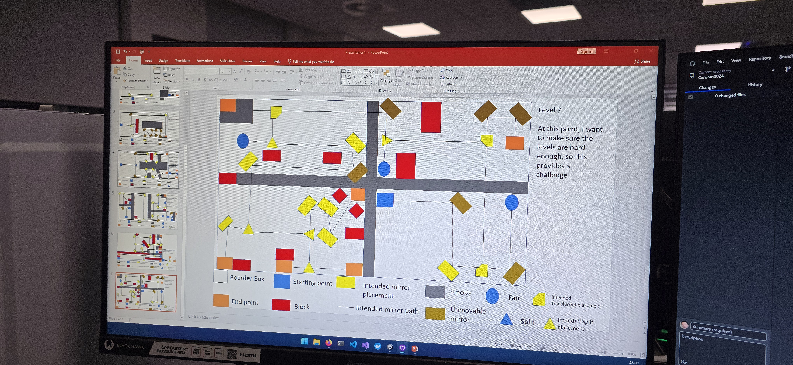
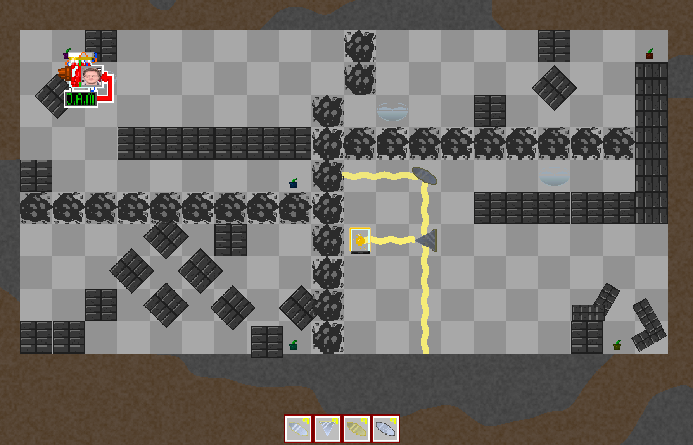
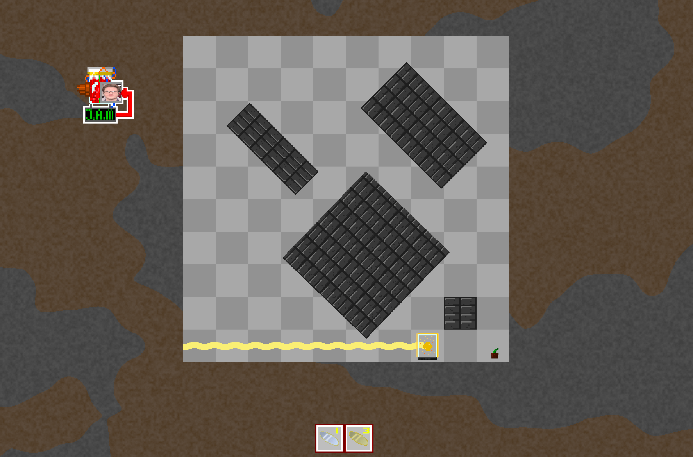
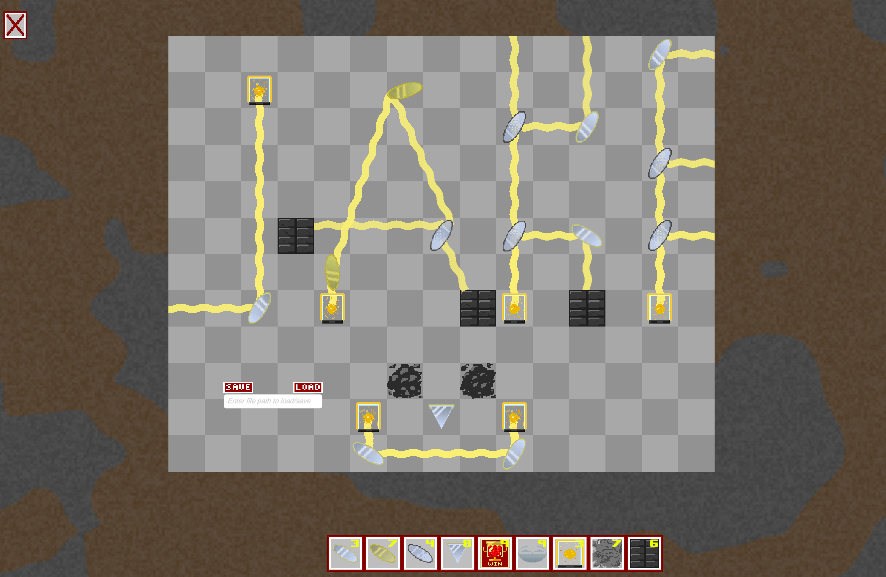
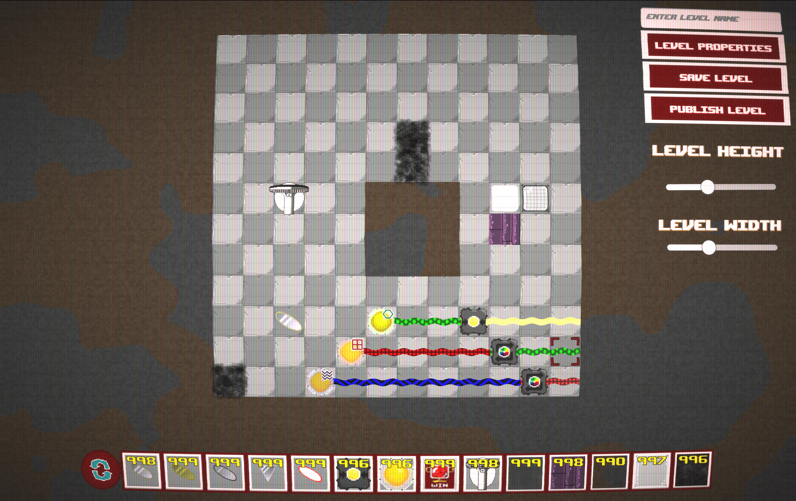
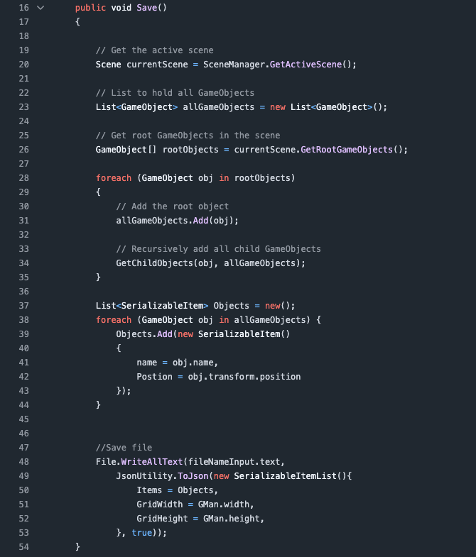
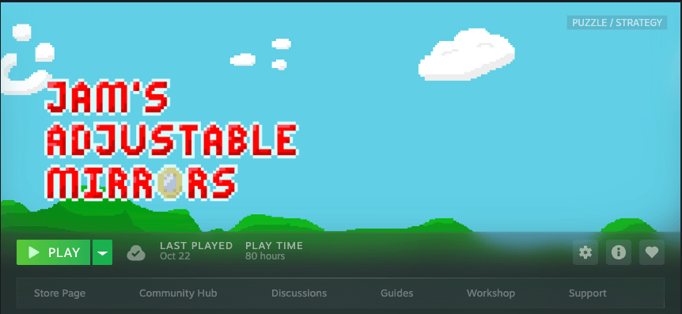

*Hi, I meant to post this during my time at Lycoris, but I actually forgot about it, originally wrote this in March 2026 but it's been quite some time. To celebrate 1 year of JAM, I'm releasing it on my own personal blog since I no longer work for Lycoris. Please keep that in mind when reading it.*

Hello, My name is Jake and I'm one of the developers behind JAM. My part in JAM involved Level Design (I built most of the levels), levels handling and the Steam integrations.

If you've never heard of JAM before it's a puzzle game where you must move mirrors to make light hit Jam plants, it is a weird concept but a fun and at times rather difficult puzzle game.

In this post I'll explain the Level Editor, a bit of JAM's level design and how they're stored, plus some extra bonus facts at the end.

# The Prototype
JAM was made in the University of Lincoln's CanJam and to be honest besides a small eight hour game jam I was in the month before and the tons of YouTube videos I'd watched, JAM was the first time I actually designed a game.

Luke and Shrug (he's also called Jake but that makes things complicated) were busy designing the JAM board and the items. Initially we had agreed on a small amount of items when planning out the concept after the theme reveal (which was mirrors, jam jars, smoke and AI).

We initially planned for about 15ish levels within the game and I was tasked with designing them while Korben and Logan created art and Lewis made the menus and music. I didn't know Unity and I cannot draw to save my own life, so I figured hey, I can probably design levels.

Jake, How do you plan levels for a puzzle game?

**PowerPoint.**

Yes, this is a real level, PowerPoint is the #1 tool of level design, fight me.
Let's see what this looks like in JAM (The CanJam beta), this level ultimately became level 15.

Ultimately, levels changed, I actually made a fair few levels that were far too hard, so only the first 7 or so levels I planned out in PowerPoint got made, with 5ish levels being reserved as a tutorial for the mechanics of the mirrors.

Originally these levels were made in the Unity editor as scenes, which is why walls don't snap to the grid, and have strange rotations and some aren't full as seen in the bottom right corner.

 This is what it roughly looked like in the Unity editor, JAM was originally made in Unity 2022 but we upgraded to 6.0 to get rid of the Unity Splash and then to 6.2 for the full release because of the Unity Exploit. Because it has been so long, I don't have the original Unity editor the JAM CanJam build was made in and so opening it in 6.2 has likely broke some stuff like the background but it was there originally.

So let's talk about the level editor and how it was made.

# The creation of the Level Editor
Towards the end of CanJam I felt like JAM was missing something and it has become sort of a trope in product announcements/game announcements to have a one more thing. This thinking led me to wonder how hard it would be to add a level editor, revealing it at the end of our demo in the game jam as a "oh one last thing, here's a working level editor!" felt like a good idea.

So with about six hours until the end of JAM, I created a level editor that spawned an empty 15x15 empty board and 9 of each item (10 would have been far too much!). This was my first time actually messing with the Unity editor besides building the levels and I didn't really know how canvases worked so while it looked good on the random uni monitor I made it on (I promise) as you'll see below it doesn't quite hold up.

With the level editor complete, people in the prototype build could create, save and share levels and eventually the level editor pretty much took over JAM.

Here's what the final one looked like:

# JAM 1.0
After CanJam was made, we started working on more levels, we spent a while cleaning up some parts of JAM and one of these was the levels.

The CanJam build worked by opening the menu -> picking a level -> asking Unity to load the scene.

In the full version JAM now has every level saved as a JSON file, like the community made levels; which is why now items conform to the grid and are regularly sized. Every level in the full release of JAM can be built in the level editor, because the level editor is how every level in JAM was made after the CanJam build.

In December 2024, we remade every level in the CanJam build in the level editor or cut them, from there we made the other 70ish levels in Level editor over 2025.

In the final version of JAM, the flow is now like this:
Main Menu -> Level picker -> Bootstrapper -> Level

In the CanJam scene based levels we had to set up the board, inventory manager etc, but this got abstracted away to be set up by the bootstrapper since it is quite arcane and parts of the final release of JAM are untouched from the CanJam build, gman (grid manager) for the most part is one of them. The bootstrapper creates a new empty Unity scene, initialises a board and the items inventory as defined within the level data; then placing everything on the board. This works the same for new levels but instead of giving the bootstrapper a file we just give it an empty board with a predefined level size. In fact for most of JAM's development you had to specify a board size before creating the level, it wasn't until a few weeks before release where Shrug added a board resize feature which in my opinion was sorely needed.

 To be honest, it's a miracle the level editor worked this well and I'm thankful it did.
 I think in a way between the Level Editor and the FUCK! clip is a good chunk of why we won CanJam 2024.

# The Elephant in the room
So if you are following so far, I never actually explained what happened to the levels now they are no longer scenes, since they have to go somewhere right?

So about the same time as writing JAM, I worked part time on a writing app; we had a very complicated XML file system which probably was amazing 20 years ago, modern .NET bundles its own XML and JSON parsers (If you don't know what XML and JSON are; they are just ways of storing data as text) and I was in the middle of moving the app I was working on from our own XML parser to the built in JSON (off the top of my head, this saved us about 3000ish lines of code and made it significantly easier to add new features) and so when I decided to make the level editor, I made it work the same way.

This is actually the whole function to save the level in the CanJam build 

This is a rough initial version, the final version has a lot of extra stuff like an items whitelist to make sure we don't save stuff like the camera or grid since it's far better to just reinitialise them. We also make sure everything we are loading is actually within the grid, this was because the items in the bar at the bottom were the actual items until late in development and we were accidentally saving them.
 There's also a lot of extra stuff for like coloured lights etc, so we had an ExData field for saving stuff like this.

# One Year Later
I realised it was coming up to about one year of release for JAM and I don't think I've played nearly at all since release. I had my fair share of fun with JAM in the many, many hours it took for Steamworks, and building all the levels.

So I figured I'd come back to it and maybe even 100% my own game. I did previously have 100% in JAM as part of testing but I relocked most of my achievements afterwards.

I didn't originally plan to make the majority of levels but did and damn I made some of these really hard, I actually can't solve them. I know they aren't impossible because someone did make a Steam guide for every level but one day I will 100% my own game.

# Bonus Stuff
- The level editor was originally its own scene but it became a prefab later on, nobody on the dev team ever thought to add a keybind to let you edit levels when playing them though, so I ended up opening levels again and again in the editor and accidentally leaving completed levels in the beta builds of JAM while I was testing it.
- The format for JAM levels is JSON but we save levels as JMSON (Pronounced JAMSON) because it sounds funny.
- The internal levels in JAM are stored in a long list to make the main menu signs show correctly, also the internal levels are saved as .txt because Unity refused to read JMSON files internally.
- There is about 5 or so levels that never even made it to the CanJam build because people looked at the PowerPoint plan and said what the fuck.
- There is about 5 or so CanJam levels that never made it to the full release.
- JAM has a 'secret' arcade mode built in for the University of Lincoln Arcademia machines.
- We originally planned to put the original 10 levels and sprites in as DLC, but this got scrapped for time and also because a lot of the levels in the CanJam build can't be made with the new level editor. For example - no item is bigger than one tile and almost all tiles can't be rotated 45° with the exception of the Free/Golden mirror which moves in increments of 2° if I recall correctly.
- The CanJam build is actually source available; all the code/assets remain property of their respective owners.
- A lot of JAM's later levels (30-60ish) were made while I was backpacking through Poland, Kazakhstan and Korea and a bit of Japan (I went more places but I made almost a full level pack in each of those countries)
- JAM's internal name is just GameJam.exe and was called CanJam 2024 until close to release.
- We joked about making an additional level pack designed around the final boss mechanic where JAM would move stuff for you and you had to use it to solve the level; no art/levels/code etc exists of this beyond the concept of Marmalade, a Wheatley-esque foil to JAM.
There'll probably be a day where a bug in the .NET JSON serialiser will come to haunt us all.

I always have multiple things in the works, so it's hard to say when the next one I'll release is, but here's a few I'm working on:

- Pacman Earth (Early December, hopefully)
- Home Monitoring Tool
- Charadrius
- Dude, Where's My Scratch Projects?
- One Year of Homelabbing.
